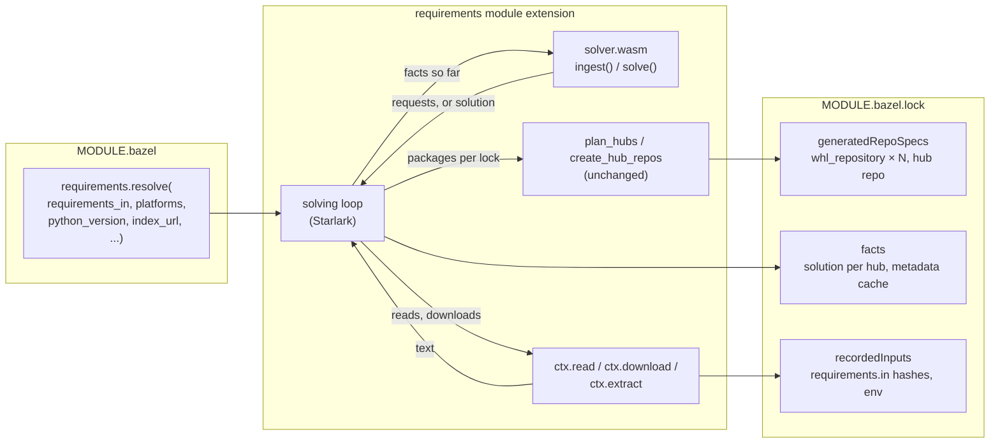
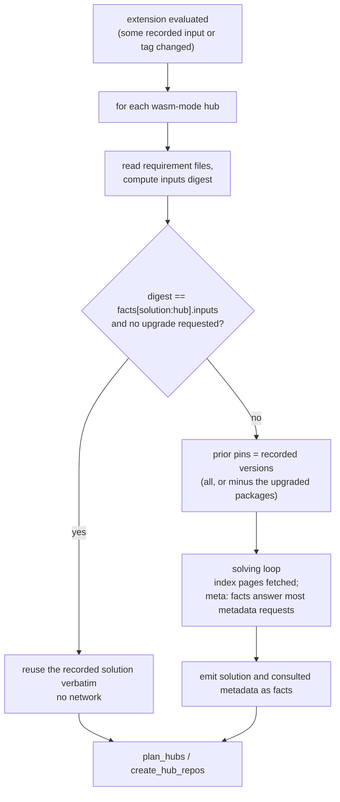

# Design: resolving requirements inside Bazel with a WebAssembly solver

Status: implemented, including the facts that make re-resolution lazy. Written against Bazel 9.3 and 10.0.0rc1 and `rules_req_compile` 1.5.0. The
module is built from [`wasm/`](../../wasm/README.md), the entry point is
[`req_compile/wasm/entry.py`](../../req_compile/wasm/entry.py), the loop is
[`req_compile/private/resolve.bzl`](../../req_compile/private/resolve.bzl), and
`requirements.resolve(...)` in `extensions/python.bzl` uses it.

## Summary

Today a hub is built from lock files that `py_reqs_compiler` writes by running the
Python solver on a host interpreter. The lock files are checked in and the module
extension only parses them.

This design adds a second way to define a hub: a `resolve` tag names
`requirements.in` files, target platforms and indexes, and the module extension
resolves them itself. The solver runs as a WebAssembly module through
`module_ctx.execute_wasm`, which can only compute. The module is CPython itself
with the unmodified `req_compile` package inside; no part of the solver is
rewritten. Every download, file read and
archive extraction is performed by Starlark, so the extension drives the solver in
rounds: the solver reports the facts it is missing, Starlark fetches them in
parallel, and the solver is run again with the larger set of facts until it
produces a solution or fails. The result is recorded by Bazel in `MODULE.bazel.lock`,
which becomes the lock: the pinned repositories live in the extension's
`generatedRepoSpecs`, and the previous solution and a metadata cache live in the
extension's `facts`, which is what makes re-resolution lazy and mostly offline.

Everything after the solve is unchanged. The solver's output is the same
`packages` structure that `parse_lockfile` produces today, so `plan_hubs`,
`create_hub_repos`, `whl_repository` and the hub repository are reused as they are.

## Goals and non-goals

Goals:

- Resolve requirements without a host Python, a toolchain or any process execution
  at extension time. The only executable code is a `.wasm` file shipped with the rules.
- One solver, one source. The module runs the `req_compile` package as it is, so a
  wasm-mode hub and a `py_reqs_compiler` lock built from the same inputs pick the
  same versions because the same code picked them.
- Cross-platform by construction. A hub resolves every platform it declares in one
  evaluation, with one version per package across platforms, as `requirements_txts`
  does today.
- `MODULE.bazel.lock` is the only lock. CI verifies it with `--lockfile_mode=error`.
- Re-resolution is lazy: changing one requirement keeps every other pin, like running
  `requirements.update` without `--upgrade`.
- Hubs built from lock files keep working unchanged, in the same extension.

Non-goals:

- Building source distributions at resolve time. Metadata of sdists is used only
  where the standards make it trustworthy without a build (see "Source distributions").
- Replacing the Python package. The CLI and `py_reqs_compiler` remain the reference.
- Supporting Bazel versions without `execute_wasm` (Bazel 9 with the experimental flag).

## What Bazel provides

These are the capabilities the design rests on. They were checked against the Bazel
9 documentation and the Bazel source on `master` in October 2026.

**`load_wasm` and `execute_wasm`.** Both exist on `repository_ctx` and, because
`ModuleExtensionContext` extends the same `StarlarkBaseExternalContext`, on
`module_ctx`. They are gated behind `--experimental_repository_ctx_execute_wasm`.

```python
module = ctx.load_wasm(path, *, compile = True, allocate_fn = "allocate", watch = "auto")
result = ctx.execute_wasm(module, "solve", input = text, timeout = 600, memory_limit = 64 * 1024 * 1024)
result.return_code   # the function's u32 return value, negative if execution failed
result.output        # the output buffer, as a string
result.error_message # set when execution failed before the function returned
```

The exported function must have the signature
`(input_ptr: *u8, input_len: u32, output_ptr_ptr: **u8, output_len_ptr: *u32) -> u32`,
and the module must export `allocate(size: u32, align: u32) -> *u8`. Bazel calls
`_initialize` if exported. `compile = True` (behind
`--experimental_repository_ctx_wasm_compilation`) compiles the module to JVM bytecode,
which the Bazel issue tracker measured at roughly 3 to 4 times slower than CPython;
the interpreter is far slower than that.

Properties that shape the protocol:

- **Every call is a fresh instance.** `StarlarkWasmModule.execute` builds a new
  `Instance` with fresh linear memory per call. No state survives between calls, so
  the solver must be a pure function of its input.
- **No imports, no WASI.** The instance is built without import values. The module
  cannot open files, read the clock or touch the network, and must be compiled for
  `wasm32-unknown-unknown` with its own allocator.
- **Strings are byte-transparent.** `ctx.read` decodes files as ISO-8859-1, the
  `input` string is passed to the module as its internal bytes, and the output buffer
  is decoded as ISO-8859-1. A file read with `ctx.read` and passed as `input` arrives
  in the module byte for byte, including UTF-8 content. The design relies on this for
  `METADATA` files. Anything that goes through `json.encode` in Starlark must be
  ASCII, since `json.encode` escapes non-ASCII characters.
- **Limits are per call.** `timeout` defaults to 600 seconds and `memory_limit` to
  64 MiB. Both are parameters, so the loop can raise them.

**Downloads.** `ctx.download(url, output, sha256, allow_fail, headers, auth, block = False)`
returns a token whose `wait()` yields the result, so one round can issue every
download at once. `headers` allows asking an index for the PEP 691 JSON form.
`allow_fail = True` turns a 404 into a result rather than a failure, which is how a
package missing from one index is handled. `ctx.extract(archive, output, type = ...)`
unpacks wheels and sdists; `ctx.path(dir).readdir()` lists what came out.

**The lockfile.** A non-reproducible extension gets an entry under `moduleExtensions`
keyed by the extension, with `bzlTransitiveDigest`, `usagesDigest`, `recordedInputs`
and `generatedRepoSpecs`. Bazel reuses the entry, skipping the extension entirely,
when the digests match and none of the recorded inputs changed. Files read with
`ctx.read` on a label are recorded inputs, environment variables read with
`ctx.getenv` are recorded inputs. On a mismatch the extension is re-evaluated,
except under `--lockfile_mode=error`, which fails the build instead.

**Facts.** `extension_metadata(facts = {...})` persists a JSON-like dict in the
lockfile and `module_ctx.facts` returns it on the next evaluation, even when the
entry is stale or missing. Facts are looked up by key only (no enumeration), they
are not invalidated by code changes, and `module_extension(facts_version = N)`
discards them when the schema changes. Facts are what make the lock more than a
cache of outputs: they carry the previous solution forward.

## Architecture



Three pieces are new: the solver module, the Starlark loop that hosts it, and the
lockfile schema. The rest is the existing pipeline fed from a different source.

## The solver module

### CPython itself, not a port

The module must be freestanding `wasm32-unknown-unknown` in effect: `execute_wasm`
instantiates it with no imports at all, so there is no WASI, no filesystem, no
clock and no network. The first draft of this design concluded that CPython could
not meet that and proposed a Rust port of the solver. The prototype shows that it
can, with surprisingly little: a CPython `wasm32-wasi` build (3.14 now, 3.13 before
it) becomes import-free by linking a few small pieces into it, and the `req_compile`
package runs inside unchanged.

| Piece | Lines | What it does |
| --- | --- | --- |
| `wasm/wasi_stubs.c` | ~400 | Defines, inside the module, every WASI function wasi-libc imports. Standard output and error are captured into buffers, the clock is a counter, `random_get` is a fixed-seed generator (so hash seeds and set ordering are reproducible), the filesystem is empty, `proc_exit` traps. |
| `wasm/shim.c` | ~130 | Exports `allocate` and `solve` with the signatures Bazel expects, embeds the interpreter, exposes the input buffer and the bundle to Python through a builtin `_host` module, and returns Python's output buffer. |
| `wasm/bootstrap.py` | ~80 | An importer over an in-memory bundle of `.py` or bytecode files, installed as the first thing after the interpreter starts. |
| `wasm/freeze_encodings.py` | ~60 | The WASI build does not freeze `encodings`, which the interpreter imports while starting, before any importer of ours can exist. This emits a `PyImport_FrozenModules` table with the six modules involved; `shim.c` installs it before `Py_InitializeFromConfig`. (3.13 offered a two-phase start-up, `_init_main = 0` then `_Py_InitializeMain()`, that let the importer go in between; 3.14 removed it.) |
| `wasm/bundle.py`, `wasm/embed.S` | ~120 | Pack the standard library (trimmed), `packaging`, `overrides`, the shims and `req_compile` into a length-prefixed blob linked into the module as data. With a host Python of the same minor version the blob holds marshalled bytecode instead of source. |

Five stand-in modules in `wasm/shims/` satisfy imports that cannot work in the box
and are never exercised by the solver: `requests` (nothing downloads), `toml` and
`setuptools` (no `pyproject.toml` or `setup.py` is evaluated), `multiprocessing.pool`
(one thread, used only to scan source trees) and `ctypes` (no dynamic loading;
`get_glibc_version` then correctly reports "not glibc"). They total forty lines.

`libpython3.X.a`, `pyconfig.h` and the link flags come from a CPython WASI build,
made by `wasm/build_cpython.sh` (the prototype used the archive of
`brettcannon/cpython-wasi-build`, which still works, slower); the vendored
`libmpdec`, `expat` and `_hacl` objects are linked alongside because they are not
in the archive. The whole build is `wasm/build.sh`. The module is 16 MB, of which
10 MB is the bundle (25 MB with the pre-initialized snapshot); its only exports are
`allocate`, `solve` and, without the snapshot, `_initialize`.

What this buys over a port is the goal of this design: the solver inside Bazel is
the solver on the command line, including `perform_compile_group`'s cross-platform
alignment, the walkback heuristics and the explanations on failure. The existing
test suite covers it, and a behaviour change lands in both places at once.

A Rust port remains the fallback if the per-call cost under Bazel's runtime (see
"Measurements") proves unacceptable, since a native-style module would start in
milliseconds. It would duplicate roughly 3,500 lines of solver and metadata code
and need a conformance suite to keep the two in step.

### The entry point

`req_compile/wasm/entry.py` is the only new solver-side code, about 500 lines.
It adapts `req_compile` to facts without changing it:

- `FactRepository(Repository)` serves candidates from `index:` facts, building them
  with `filename_to_candidate` and filtering with `check_python_compatibility`
  exactly as `PyPIRepository` does, and serves metadata from `meta:` facts through
  `_parse_flat_metadata`. When a fact is missing it records a request and raises
  `NeedFacts`, which ends the round.
- Requirement files are read through `RequirementsFile.from_file`, with `builtins.open`
  redirected to `file:` facts for the duration of the solve, so `-r` includes
  resolve relative to the including file as they do on the command line, and a
  `-c FILE` option of a requirements file is read as a constraints file. Every
  other option in a file (`--index-url`, `--find-links`, `--no-binary`, ...) is
  refused with a message pointing at the `resolve` attribute, since an option that
  silently did not apply would resolve against the wrong index. The solver
  reports the files each hub read, includes and all, and the extension records
  them with the solution (`req_compile/wasm/files.py` holds this).
- `solve` builds one `TargetEnvironment.from_spec` per platform, one repository per
  target and index, and calls `perform_compile_group` with the hub's prior pins as
  soft pins. The solution is rendered from the dependency graph itself (`node.dependencies`,
  `node.reverse_deps`), not from `# via` comments.
- `ingest` compacts raw documents: a PEP 691 JSON or PEP 503 HTML index page becomes
  its list of files with hashes, `Requires-Python`, yanked flags and PEP 658/714
  core-metadata availability; a `METADATA` or `PKG-INFO` becomes its header,
  `Dynamic` fields and metadata version.

One exported function, `solve`, dispatches on the `op` of its JSON input: `ping`,
`ingest` and `solve`. Documents fetched during a round travel in the next `solve`
call's `documents` field and are ingested before solving, so a round is one call.

### Encoding at the boundary

The prototype passes everything as JSON. Starlark reads files as ISO-8859-1 and
`json.encode` escapes anything non-ASCII, so a string that carries file bytes arrives
in Python as one character per byte; `entry._decode` re-encodes it as Latin-1 and
decodes UTF-8. Everything the module returns is ASCII-only JSON, which Starlark can
`json.decode` and later `json.encode` again without any re-encoding. A header-plus-raw-payload
envelope, as the first draft proposed, is still an option if large documents make
JSON escaping a measurable cost; it has not been needed.

### Compact facts

Facts are keyed strings. The key is also the cache key for the whole system: in the
loop's dictionary during one evaluation, and in the lockfile's `facts` across
evaluations.

| Key | Produced by | Contents |
| --- | --- | --- |
| `file:<label>` | `ctx.read` | the raw text of a requirements or constraints file (a payload, not JSON) |
| `dir:<label>` | `readdir` | the file names of a `find_links` directory |
| `index:<index url>/<normalized name>/` | `ingest(kind="index")` | `[{filename, url, sha256, requires_python, yanked, core_metadata: {sha256} or true or false}]` |
| `meta:<sha256 of the distribution>` | `ingest(kind="metadata")` | `{metadata, dynamic, metadata_version, digest}`: the header fields the solver reads (`Metadata-Version`, `Name`, `Version`, `Requires-Dist`, `Requires-Python`, `Provides-Extra`, `Dynamic`), nothing else, and the sha256 of that text |

`meta:*` facts are immutable: the distribution with that hash has that metadata
forever. They are the facts worth carrying across evaluations, and the lockfile
carries them by content: `md:<digest of the trimmed text>`, once per distinct
text, which a package's wheels for several platforms share, and each recorded
package names the digest of its own. The solver joins the two when it loads a
prior solution. Trimming means the recorded text can no longer be compared with
the hash an index advertises for its metadata file; that comparison is made when
the file is downloaded, and from then on the lock is the record. `index:*` facts
are not carried: a new release changes them, and that is exactly what a
re-resolution should see.

## The solving loop

### Protocol

`solve` returns one of three results.

```json
{"status": "need", "requests": [
  {"id": "file:/inputs/constraints.in", "op": "read", "path": "/inputs/constraints.in"},
  {"id": "index:https://pypi.org/simple/requests/", "op": "fetch",
   "url": "https://pypi.org/simple/requests/",
   "headers": {"Accept": "application/vnd.pypi.simple.v1+json, text/html;q=0.1"},
   "ingest": "index"},
  {"id": "meta:70761cfe...", "op": "metadata", "kind": "wheel",
   "url": "https://files.pythonhosted.org/packages/.../requests-2.32.3-py3-none-any.whl",
   "sha256": "70761cfe...", "core_metadata": {"sha256": "0e4b7d1a..."},
   "filename": "requests-2.32.3-py3-none-any.whl"}
], "facts": {"...": "the compact form of the documents this call ingested"}}
```

Requirement files are addressed by paths under `/inputs/`; the extension maps them
to labels (`/inputs/<package>/<file>`) and back. Raw documents go to the next call
as `documents`, keyed by request id, with the `kind` to ingest them as and the body
as read by `ctx.read`; the call answers with their compact facts, which Starlark
merges into its dictionary.

```json
{"status": "done",
 "hubs": {"pip_deps": {"locks": {"manylinux_2_28_x86_64": {"packages": {
   "requests": {"package": "requests", "version": "2.32.3", "sha256": "70761cfe...",
                "url": "https://files.pythonhosted.org/.../requests-2.32.3-py3-none-any.whl",
                "deps": ["certifi", "charset_normalizer", "idna", "urllib3"],
                "via": ["@@//3rdparty:requirements.in"]}}}}}},
 "consulted": ["70761cfe...", "..."]}
```

```json
{"status": "error", "message": "No candidate for urllib3<2 ...", "explanation": ["requests==2.32.3 (via ...)", "..."]}
```

The `packages` dict of a lock is exactly what `parse_lockfile` returns today
(`package`, `version`, `sha256`, `url`, `whl`, `deps`, `annotations`), so the loop
hands it to `plan_hubs` without translation. `whl` is set instead of `url` for
distributions that came from a `find_links` directory, with the same label
arithmetic `lockfile.bzl` does now.

The loop, as `req_compile/private/resolve.bzl` implements it (the `ctx.facts` lookup is the part still to come):

```python
def resolve_hubs(ctx, module, hubs, prior):
    facts = {}
    documents = {}
    for _ in range(ctx.attr.max_rounds):
        out = _solve(ctx, module, hubs, facts, documents, prior)
        facts.update(out.get("facts", {}))
        documents = {}
        if out["status"] == "done":
            return out
        if out["status"] == "error":
            fail("resolution failed: " + out["message"])

        pending = []
        for req in out["requests"]:
            if req["op"] == "read":
                facts[req["id"]] = {"text": ctx.read(_label_for(req["path"]))}
            elif req["op"] == "fetch":
                path = _scratch(req)
                pending.append((req, path, ctx.download(
                    url = req["url"], output = path, headers = req.get("headers", {}),
                    auth = _auth(ctx, req["url"]), allow_fail = True, block = False)))
            elif req["op"] == "metadata":
                cached = ctx.facts.get("meta:" + req["sha256"])
                if cached:
                    facts[req["id"]] = cached
                else:
                    pending.append(_start_metadata_download(ctx, req))

        for req, path, token in pending:
            result = token.wait()
            if not result.success:
                facts[req["id"]] = {"error": "download failed: " + req["url"]}
            elif req["op"] == "fetch":
                documents[req["id"]] = {"kind": "index", "url": req["url"], "body": ctx.read(path)}
            else:
                documents[req["id"]] = {"kind": "metadata", "url": req["url"], "body": _metadata_text(ctx, req, path)}
    fail("resolution did not converge in {} rounds".format(ctx.attr.max_rounds))
```

Every request of a round is issued before any is waited on, so a round costs one
network round trip plus extraction time. The solver is deterministic, so a round
that adds no facts is a bug and is reported as one rather than looping.

### Why replay rather than resume

The alternative to re-running the solver from scratch each round is to serialise
its internal state (the partial graph, the walkback stack) between calls. Replay is
preferred: the solver stays a pure function of facts, nothing about its internals
leaks into the protocol, and a round that fails can be reproduced offline from the
facts dictionary alone. Its cost is CPU per round on compact facts, which `ingest`
keeps small. A resolve of a few hundred packages re-parses a few hundred kilobytes
of JSON per round.

The solver itself stops at the first missing fact, since `compile_roots` is not
written to continue past one. Left alone that would advance one package per round;
the prototype's first three-platform run needed more than fifty. The round count is
kept low by *speculation* instead: when a round ends, the entry point also requests
every fact the next rounds will evidently need, and the solver never changed.

- The index page of every requirement in the input files and constraints, of every
  prior pin, and of every requirement named by `Requires-Dist` in known metadata
  whose markers hold for some target.
- The metadata of the best candidate for each of those requirements per target,
  chosen with `filter_candidates` and `sort_candidates` against the requirement's
  own specifier (or the pin), so the version the solver will most likely pick is
  the one fetched.

With that, a resolve advances a whole level of the graph per two rounds and usually
less, because speculation reaches ahead of the solver:

| Case | Rounds |
| --- | --- |
| `requests` for one platform | 5 (read, page, metadata, pages of four dependencies, their metadata) |
| This repository's requirements, 61 packages, three platforms, from the checked-in pins | 4 |

Requirements files with `-r` and `-c` includes are read by the solver through its
normal file reading, redirected to facts, which is why file reads are requests like
any other. An included file keeps the package of the file including it, whatever
subdirectory it sits in, since a subdirectory without a `BUILD` file is no package;
only an include that leaves the package is mapped by its path.

### Getting metadata

Only the dependency list of a distribution is needed, never the distribution. The
loop obtains it, in order of preference:

1. **Core metadata served by the index** (PEP 658, PEP 714). The index page says
   whether `<file url>.metadata` exists (`core-metadata` in JSON, `data-core-metadata`
   in HTML, with the legacy `dist-info-metadata` names as fallback) and usually gives
   its sha256. PyPI serves it for virtually every wheel. The download is a few
   kilobytes and, when the hash is known, is served from Bazel's repository cache on
   later evaluations.
2. **The wheel itself.** When the index does not advertise metadata, the loop
   downloads the wheel with its sha256, extracts it with `ctx.extract(type = "zip")`
   into a scratch directory, finds the single `*.dist-info` directory with
   `readdir`, and reads `METADATA`. This is the slow path and is reported with
   `report_progress`. Range requests to read only the zip directory are not possible,
   `ctx.download` has no range support.
3. **Source distributions.** See below.

Whatever the path, the text goes through `ingest(kind = "metadata")` and becomes a
`meta:<sha256>` fact.

### Source distributions

`execute_wasm` cannot run a build backend, and req-compile's Bazel mode already
defaults to `allow_sdists = False`. In wasm mode, with `allow_sdists = False` the
solver considers wheels only. With `allow_sdists = True` an sdist is usable when its
metadata is trustworthy without a build: PEP 643 guarantees that a field of an
sdist's `PKG-INFO` with `Metadata-Version` 2.2 or newer that is not listed under
`Dynamic` is exactly what any wheel built from it will have. The loop obtains
`PKG-INFO` like `METADATA` (index-served core metadata first, else download the
archive, which `ctx.extract` unpacks by its extension, and read
`<name>-<version>/PKG-INFO`). If
`Requires-Dist` or `Requires-Python` is dynamic or the metadata version is older,
the candidate is rejected with reason `SDIST_METADATA_NOT_STATIC`, which appears in
the failure explanation so the user can pin a version that ships wheels. Building
the sdist at fetch time in `whl_repository` is unchanged.

### `find_links` and local wheels

A `find_links` directory is named by a label of a file inside it (its `BUILD.bazel`),
as the examples do today. The loop lists the directory with `readdir` and
`ctx.watch_tree` so that adding or replacing a wheel invalidates the lock entry.
Local wheels have no index page and no advertised hash, so the loop extracts each
candidate wheel directly for its metadata, and its `meta:` key is derived from the
label rather than a sha256. The resulting lock entry uses `whl` (a label) instead of
`url`, as `find_links` entries do today, and `whl_repository` reads the file from the
tree as it does now.

### Authentication

Private indexes are reached with `auth` built from `~/.netrc` through
`read_user_netrc` and `use_netrc` of `@bazel_tools//tools/build_defs/repo:utils.bzl`,
the same mechanism `http_archive` uses. Credentials are passed to `ctx.download` only.
The lockfile records URLs without credentials in `generatedRepoSpecs`, and
`whl_repository` resolves the same netrc at fetch time. Environment variables the
netrc helpers read become recorded inputs, which is acceptable: `NETRC` rarely changes.

### One loop for the whole extension

All wasm-mode hubs of all modules are resolved in a single loop. The solver input
holds every hub; the facts dictionary is shared, so two hubs needing the same index
page or distribution fetch it once; and a round's requests are the union over hubs,
which maximises the parallelism of each round. Within a hub, the platforms are
compiled together with the group algorithm (`perform_compile_group`), so one version
of each package serves every platform of the hub, and a package that no version can
serve on every platform fails with the same explanation `py_reqs_compiler` prints.

## Measurements

All measurements are from the prototype on an Apple M-series laptop, October 2026.
"ping" is the floor of a call: interpreter start, the bundle importer and the import
of the solver, without any solving.

| What | Result |
| --- | --- |
| `ping`, wasmtime, source bundle | 0.35 s |
| `ping`, wasmtime, bytecode bundle | 0.05 s |
| `ping`, Bazel 9.3 (interpreted, the only mode it has) | 60 s |
| `ping`, Bazel 10.0.0rc1 with `--experimental_repository_ctx_wasm_compilation`, source bundle | 12.6 s |
| `ping`, Bazel 10.0.0rc1 compiled, bytecode bundle | 10.2 s |
| `requests`, one platform, Bazel 9.3 interpreted, with a separate ingest call per document | 16 calls, 1006 s in the module, 17 minutes elapsed |
| `requests`, one platform, Bazel 10.0.0rc1 compiled, bytecode bundle | 6 calls, 97 s in the module, 99 s elapsed |
| `requests`, two platforms, through the `requirements` extension, Bazel 10.0.0rc1 compiled | 5 calls, 107 s in the module, 117 s including the wheel fetches; a rebuild with the lock entry in place evaluates nothing |
| Adding `rich` to that file (four new packages, three levels deep) | 7 calls, 134 s; every existing version kept, nothing re-fetched for them |
| Re-evaluating the extension with the requirements unchanged (code change) | 0 calls, no module load; the hub is rebuilt from facts |
| `requests`, one platform, host driver under wasmtime | 5 rounds, 4 s |
| This repository's requirements, three platforms, host driver, from the checked-in pins | 4 rounds, 57 s (network-bound), identical versions to all three checked-in locks |

Two conclusions. First, the approach is correct: the untouched solver produces the
same answers inside the module as outside, including the cross-platform alignment,
and lazily reproduces an existing solution from prior pins. Second, Bazel's
WebAssembly runtime is the cost, and the reason is now known rather than likely:
Bazel compiles with Chicory's `InterpreterFallback.SILENT`, and running Chicory's
compiler on the module with warnings on names the functions it interprets:
`_PyEval_EvalFrameDefault`, CPython's bytecode loop, and
`_PyUnicode_InitStaticStrings`. Every Python bytecode therefore runs under two
interpreters while the C helpers run compiled, a ratio of a few hundred to one
against wasmtime for Python-heavy work. Calls, not bytes, are what the design must
minimize, and so is the amount of Python each call executes.

### What the optimization pass changed

| What | Before | After |
| --- | --- | --- |
| `ping` (the floor of a call), Bazel 10 compiled | 10.2 s | 0.0 s |
| Ingest of a 1.8 MB index page | 16.2 s | about 1 s |
| Solve of 61 packages for three platforms with every fact present | 273 s | 2.5 s (88 s before the evaluation loop compiled, 8.9 s before the trampoline interpreter; 1.3 s with the JIT flag) |
| Adding `rich` to the example's `requests` hub (7 calls) | 134 s in the module, 139 s elapsed | 1.3 s in the module, 2.0 s elapsed |
| Fresh resolve of both example hubs, no facts (4 calls) | 70 s elapsed | 1.6 s in the module, 15 s elapsed, most of it fetching the wheels |
| Re-evaluation of the example with facts recorded (3 calls) | | 3 s in the module, 11 s elapsed |

- **Wizer pre-initialization.** `wasm/build.sh` with `WIZER` set runs the
  interpreter start and the solver's imports at build time and snapshots the
  memory into the module. `wasm/merge_segments.py` then drops the empty
  placeholder segments Wizer leaves and merges the rest, from 103,054 segments to
  15, which keeps the module within runtime limits and instantiation cheap. The
  module grows from 16 MB to 25 MB.
- **Less Python per call** in `entry.py`: candidates built once per page and
  shared across platforms (`PageCache`), memoized `Requires-Python` and wheel-tag
  checks, uninstallable artifacts filtered once per platform with the pre-release
  policy preserved, and no `urljoin` for absolute URLs. Natively the full solve
  went from 0.34 s to 0.09 s with identical artifacts.
- **A compiled evaluation loop.** A Flight Recorder profile of the full solve
  under Bazel's Chicory showed 92% of samples in the interpreter and 3% in
  compiled code. `_PyEval_EvalFrameDefault` was 66 KB of wasm in the stock `-O3`
  build, just over what fits one JVM method. `wasm/build_cpython.sh` builds
  CPython with `-Os` and `ceval.c` with `-Oz -fno-inline-functions -mllvm
  -ir-outliner` (52 KB), and `build.sh` no longer passes `-O2` to the linker,
  which alone pushed the function back over the limit. Chicory then interprets
  nothing. Full solve: 88 s to 8.9 s.
- **A JIT-compiled evaluation loop.** Chicory's output for it is a 60 KB JVM
  method, which HotSpot runs in its own interpreter: the huge-method limit skips
  it, C1 runs out of virtual registers on it, and C2 runs out of nodes at the
  default budget. With `-XX:-DontCompileHugeMethods -XX:MaxNodeLimit=2000000
  -XX:NodeLimitFudgeFactor=100000` C2 compiles it. In a long-lived JVM a solve
  call drops from 8.5 s to 1.6 s once warm (the third call); inside Bazel, where
  each evaluation starts from a cold class and C2 recompiles the method a few
  times before it settles, the same solve measured 5.6 s, 3.5 s and 4.6 s over
  three calls against 8.9 s without the flags.
- **A trampoline interpreter** (CPython 3.14, `TRAMPOLINE=1` in
  `build_cpython.sh`). Moving from 3.13 to 3.14 changed nothing by itself (the
  same 8.9 s). 3.14's tail-calling interpreter, one C function per bytecode
  instruction, cannot be used as is: it requires `preserve_none`, which clang
  lacks for wasm, and Chicory 1.7.5 compiles tail calls as call-plus-return,
  which would overflow the stack. `wasm/patches/cpython-3.14-trampoline-interpreter.patch`
  (170 lines, macros only) keeps the generated per-instruction functions and
  turns each tail call into a return to a small loop that calls the next
  handler. The evaluation loop becomes 328 bytes of wasm and the largest of the
  234 handlers 1.5 KB, so no function is near either limit and HotSpot compiles
  the hot handlers unaided. The call-and-return per bytecode costs 2x under
  wasmtime (0.57 s against 0.27 s for the full solve) and wins 3.5x under
  Chicory: 3.2 s, 2.6 s and 2.5 s over three calls in Bazel with default JVM
  flags, 2.2 s, 1.4 s and 1.3 s with them. Of the JVM flags only
  `-XX:-DontCompileHugeMethods` still matters (other CPython functions exceed
  HotSpot's 8,000-byte limit; 3.1 s to 1.9 s warm in a long-lived JVM); the
  node-budget flags were for the method that no longer exists, so the example's
  `.bazelrc` keeps just the one.

Memory: the module declares 64 MiB and grows; `memory_limit` is set to 1 GiB in the
prototype and peak use has not been measured yet.

## Storing the lock in `MODULE.bazel.lock`

### What lives where

| Information | Where | Written by |
| --- | --- | --- |
| Inputs: requirement files, platforms, Python version, indexes, options | `MODULE.bazel` `resolve` tag | the user |
| Hashes of every requirements and constraints file read, environment variables read, repo mapping | `moduleExtensions[...].recordedInputs` | Bazel, from `ctx.read` / `ctx.getenv` |
| Digest of the extension code and of all tags | `bzlTransitiveDigest`, `usagesDigest` | Bazel |
| Every pinned distribution: package, version, URLs, sha256, which hubs and locks use it and the dependencies each resolved | `generatedRepoSpecs` (one `whl_repository` per distribution) | Bazel, from the repositories the extension declares |
| Each hub: its locks, their config settings, package to repository per lock | `generatedRepoSpecs` (one `py_requirements_repository` per hub) | Bazel |
| The previous solution per hub: the inputs it was solved from, its first index, each distinct artifact once keyed by its sha256 (package, version, URL, dependencies, `Requires-Python`, whether the index serves its metadata separately, the digest of its metadata, and its index only when not the first) and per platform the package to artifact pick, carrying its own dependencies only where markers make them differ | `facts["solution:<hub>"]` (`schema` 1) | the extension |
| The trimmed metadata of every recorded artifact, once per distinct text | `facts["md:<digest>"]` | the extension |
| Schema version of the facts | `factsVersions` | Bazel, from `module_extension(facts_version = ...)` |

The `generatedRepoSpecs` entries are the lock in the strict sense: they are what
Bazel instantiates without running the extension, and they carry URL, hash, version
and dependency edges, the same information a `requirements.txt` carries today. An
entry looks like this:

```json
"requests_2_32_3_70761cfe": {
  "repoRuleId": "@@rules_req_compile+//req_compile/private:whl_repo.bzl%whl_repository",
  "attributes": {
    "package": "requests",
    "version": "2.32.3",
    "sha256": "70761cfe03c773ceb22aa2f671b4757976145175cdfca038c02654d061d6dcc6",
    "urls": ["https://files.pythonhosted.org/packages/f9/9b/.../requests-2.32.3-py3-none-any.whl"],
    "hubs": "{\"pip_deps\":{\"default_lock\":null,\"locks\":{\"manylinux_2_28_x86_64\":{\"config_setting\":\"@pip_deps//:manylinux_2_28_x86_64\",\"deps\":[\"certifi\",\"charset_normalizer\",\"idna\",\"urllib3\"]}}}}",
    "annotations": "{}"
  }
}
```

### The `facts` schema

```json
"facts": {
  "@@rules_req_compile+//extensions:python.bzl%requirements": {
    "solution:pip_deps": {
      "inputs": "9f2c...",
      "locks": {
        "manylinux_2_28_x86_64": {
          "requests": {"version": "2.32.3", "sha256": "70761cfe...", "url": "https://...", "deps": ["certifi", "..."], "via": ["@@//3rdparty:requirements.in"]}
        }
      }
    },
    "meta:70761cfe...": {"name": "requests", "version": "2.32.3",
                         "requires_dist": ["charset_normalizer<4,>=2", "idna<4,>=2.5", "urllib3<3,>=1.21.1", "certifi>=2017.4.17", "PySocks!=1.5.7,>=1.5.6; extra == \"socks\"", "..."],
                         "requires_python": ">=3.8", "provides_extra": ["security", "socks", "use_chardet_on_py3"]}
  }
}
```

Keys are flat and self-describing because `module_ctx.facts` can only be looked up by
key and because Bazel reserves the right to shallow-merge facts dicts. The extension
re-emits a `solution:` key per hub and an `md:` key per metadata text the hubs'
packages refer to. Anything not re-emitted disappears, which is the garbage
collection: metadata of a distribution no longer reachable from any hub leaves
the lock on the next evaluation. For the example workspace (ten packages, two
hubs) the facts went from 37 KB to 18 KB: the metadata from 22 KB in 12 entries
to 4.7 KB in 9, the solutions from 15 KB to 13 KB, most of what remains being
artifact URLs and digests. The gain is larger where it matters: a 149-package
workspace measured 905 KB of facts before, 731 KB of it metadata, mostly long
descriptions stored once per platform.

`inputs` holds the hub's tag attributes (the solver label and which files are
requirements and which constraints among them) and the meaningful lines of every
file the solve read, the files the tag names and the files those include, with
comments, blank lines and trailing whitespace dropped. Starlark cannot hash, but
it can compare, and so reduced the files are small; equality with the current
inputs is what makes per-hub memoization possible without loading the solver,
and an edit to a comment does not re-solve. Bazel's own `recordedInputs` decide
whether the extension is evaluated at all; the copy in the facts is what tells,
once it is, which hubs' inputs changed and which can be rebuilt as recorded. The
included files are known only from the recorded solution, so the comparison reads
them from there (`ctx.read`, which also makes Bazel watch them) once the files the
tag names have matched. `schema` guards against reading a fact written by another
version of this code, since facts outlive code changes. Replacing the module file
behind an unchanged `solver` label does not re-solve; `REQ_COMPILE_UPGRADE` does.

### How an evaluation uses the facts



Three mechanisms do the work, all in place:

- **Per-hub memoization.** `resolve_hubs` compares the recorded inputs with the
  current ones before anything else. Equal means the recorded packages go straight
  to `plan_hubs`: no module load, no network, no solver call.
- **Prior pins and recorded metadata.** A hub whose inputs changed is solved with
  the recorded versions as soft pins (`perform_compile_group`'s `pins`), the
  requirement files pre-seeded as `file:` facts, and every recorded `md:` fact
  pre-seeded, so the first call already knows the metadata of everything it keeps.
- **Synthetic index pages.** A recorded distribution answers only for the index it
  was recorded from and only if its `Requires-Python` fits the target, both
  recorded with it; a changed Python version or a removed index fetches the page.
  `FactRepository.get_candidates` answers from the
  recorded distribution of a project whenever its version satisfies the requirement
  asked for, and requests the real page only when it does not. A package the change
  leaves alone therefore costs neither a page fetch nor a round; one that must move
  costs exactly what a fresh package costs.

Two consequences matter to users:

- **Changing one hub does not re-resolve the others.** Any change to any recorded
  input re-runs the whole extension, including file-based hubs in the same
  extension, but a hub whose own inputs did not change is rebuilt from its recorded
  solution without a network request. This is why the lock-file-based hubs can stay
  in the same extension: their cost on re-evaluation is a few file reads.
- **Re-resolution is lazy.** The recorded versions are passed to the solver as soft
  pins, the mechanism `perform_compile_group` already has for recycling solutions:
  a package keeps its version unless the new requirements make it unusable, in which
  case it is re-resolved and its dependents are aligned. Adding `httpx` to
  `requirements.in` changes `httpx` and whatever it newly requires, nothing else.
  Most metadata requests are answered from the recorded `md:` facts, so a typical
  re-resolution fetches index pages only.

### Upgrading

The extension is a function of its inputs, so there is no "upgrade" input unless
one is provided. Every place that tells the user how to move a pin says the same
two things, in this order:

1. A hub with `requirements_txt`:
   `REQ_COMPILE_UPGRADE=<package>[,<package>] bazel run @<hub>//:requirements.update`
   (`all` for every package). The extension resolves those packages again from
   the index, ignoring their pins in the file, and the update writes the result.
2. A hub with no `requirements_txt` has only the lock to move:
   `REQ_COMPILE_UPGRADE=<package>[,<package>] bazel mod deps` (or any build
   that needs the hub).

There is no flag on `requirements.update` for this, deliberately: a flag on a
`bazel run` binary can only change how the extension resolves by running Bazel
again from inside the binary, and req-compile's tools do not invoke Bazel
(1.6.2 to 1.6.4 had such a `--upgrade` flag; it was removed in 1.6.5). The
extension reads one environment variable (`REQ_COMPILE_UPGRADE`, implemented in
`resolve.bzl`).
`ctx.getenv("REQ_COMPILE_UPGRADE")` makes it a recorded input, so the extension
re-runs when it is set, dropping the named prior pins (or all of them). The next
command without the variable sees a changed recorded input and re-runs once more,
but the inputs digest now matches the fresh solution, so that run reuses it without
network access and simply records the variable as unset. `bazel mod deps` is used
because it evaluates every extension unconditionally; any build that needs the hub
works as well. A solution produced under the variable records that fact in its
inputs (`upgrade` in `solution:<hub>`), and `_unchanged` never treats such a
solution as current: the next evaluation without the variable solves again,
from the recorded versions and the file's pins, and records a solution without
the mark. That matters when the upgrade is backed out: `git checkout` of the
pinned file restores the very text the upgrade was solved from, and without the
mark the lock would keep the upgraded versions and the next
`requirements.update` would write them back into the file (found by the factory
workspace on 1.6.4).

### Verifying in CI

`--lockfile_mode=error` fails a build whose extension entry is missing or whose
recorded inputs changed, with Bazel's own message naming the extension. It never
performs network access for a non-reproducible extension. That replaces
`py_reqs_solution_test` for wasm-mode hubs: a developer who edits `requirements.in`
and does not run a build before committing gets a CI failure pointing at the lock.

### Dependabot-managed requirement files

A fully pinned `requirements.txt`, hashes included, works as `requirements_in`: the
file reader already skips comments and continuation lines and strips `--hash`
options, so the compiled lock of this repository fed back as input reproduces its
61 artifacts exactly. That makes the resolve mode the way to let Dependabot bump
pins: Dependabot's `pip` updater edits versions and hashes in such a file and
leaves comments alone, which breaks the lock-file mode (the URL comment under each
entry goes stale) but is exactly what the resolve mode wants.

Three rules make the file trustworthy, the first two those of `pip
--require-hashes`. With `enforce_hashes` (the default) the artifact chosen for a
project must carry one of the hashes the file pins for it; a version bumped
without its hashes fails with a message naming the package, the pinned hashes and
what every index offers (a mismatch on one index is an error only if no index
matches), so the file's hashes are an integrity check rather than decoration.
Once a file pins hashes, every package must be pinned: a project that reaches the
solution without a pin fails naming the project. And with pins in force the
metadata of a distribution is read from the pinned bytes themselves rather than
from the metadata file the index serves separately, which only the same index
vouches for; an index therefore cannot describe a pinned wheel as another version
or with other dependencies. (Without pins the separately served file is used when
it carries a hash, as pip does; one advertised without a hash is never fetched.)
Both `--hash=sha256:...` and `--hash sha256:...` are pins; other algorithms are
refused rather than ignored. And the file's pins are hard pins, as they are for
pip: a bump whose own requirements reject another pinned package fails with
req-compile's explanation instead of moving the other pin. (That is the file as
`requirements_in`; the hub-maintained file below is softer.)

The usual arrangement, though, keeps a loose `requirements.in` for humans and
lets the hub maintain the pinned file: `requirements_txt` on the tag names it,
the hub renders it from its solution (`render_pins` in
`req_compile/private/pins.bzl`: every package at its version, the sha256 of each
artifact the hub's platforms use, `# via` from the dependency graph, the hub's
indexes at the top) and exposes `requirements.update`, which writes it into the
workspace, and `requirements.test`, which fails while the workspace copy no
longer pins what the hub resolved, the role `py_reqs_solution_test` plays for
compiled locks. The comparison is by meaning: the same packages at the same
versions, each with at least the hashes of the artifacts the hub uses. Dependabot
regenerates the file with pip-compile when a `.in` file exists, which writes the
hash of every file of a release in its own layout, and that passes; so do
`2.0.0` or `===2.0` for `2.0`, a tab before a comment and a package pinned twice
at one version, while a package pinned twice at different versions or an `-r`
include, which the test does not follow, fail naming it. Markers are not
evaluated (a pin with one is a pin). Fed back to the hub, the file plays the
part the existing lock plays for pip-compile and for `req-compile --solution`:
its versions are soft pins (`perform_compile_group`'s `pins`, the same channel
as the recorded solution's versions, which the file outranks), so a package
keeps its pinned version while `requirements.in` and the other packages allow
it, and is resolved again when they do not, with no flag to pass: bumping
`idna>=3.20` in the `.in` against an `idna==3.19` pin just moves idna. The
file's hashes vouch for the pinned version only (`FactRepository.file_pins`,
`_file_pinned`): an artifact of that version with another hash is left out, and
when none of its artifacts match while the requirements still allow the
version, that is an error, so a Dependabot bump with a wrong hash cannot resolve
quietly to something else; a version the file does not pin needs no hash, and
`requirements.update` writes it. Two refinements keep that promise. First, the
solver cannot tell, while it resolves, whether it is leaving a pinned version
because a requirement excludes it or because nothing usable of it matched the
hashes (a mismatch is noted per repository so that a second index may still
supply the right artifact, but a matching sdist the hub may not install, a
release with no wheel for one platform, or an older release on another index all
make the soft pin yield as "no candidate"); so `_check_file_pins` judges the
finished solution instead: a pinned version that every requirement on the
package in the solution, and every constraint file, still allows must be the one
used, with one of its hashes, or the solve fails naming the package, the
platform with the least to offer and the artifacts the index has for that
version (`PinNotUsed`, or the noted hash mismatch when there is one). Found by
the factory workspace: a Dependabot bump of certifi whose wheel hash was wrong
but whose sdist hash was right came back as the previous version, and the stale
test's advice to run `requirements.update` would then have erased the bump.
Second, a pin without a local segment
covers every build of its release (`same_release`: `1.0` covers `1.0+cpu`), its
hashes saying which build is meant, so the soft pin `==1.0` cannot drift onto a
local build. A recorded distribution yields to the file (`_recorded`): when the
file pins another version or another artifact, the page is fetched. Metadata
provenance follows the same rule: each recorded distribution notes whether its
metadata came from the index's separately served file (`sidecar` in the lock's
artifact, set from the document Starlark hands back), and `ensure_metadata`
re-reads the wheel itself once the file vouches for the artifact, so a lie an
index told while nothing pinned the package does not survive the pin. (Locks
written before this field treat their metadata as wheel-derived, which it was
for every hub that had a pinned file, since such hubs read all metadata from
wheels then.) In req-compile itself, a soft pin now yields before the solver
walks back a reverse dependency to keep it (`compile.py`, the
`PinConflictException` raised ahead of `_get_strictest_reverse_dep`): raising
`a>=2` when the new `a` needs `b>=2` moves the pinned `b` instead of failing
with "no candidate for a satisfies !=2.0,>=2". Packages the file does not list yet resolve freely and then appear
in it, as do the packages `REQ_COMPILE_UPGRADE` names (all of them with `all`),
whose pin and hashes are left out for that one resolution so that
`requirements.update` writes their new version; that is for moving a pin the
requirements still allow, and the one way to lift a hash in the file that keeps
the hub from resolving at all (the one case a soft pin can still block), which
the failure message of a pinned hub says. The update script itself only writes
the rendered file, and leaves it alone when it is already up to date; the lock
records the file as it was when the hub resolved, and the next Bazel command
(or `bazel mod deps --lockfile_mode=update`) brings it up to date, as with
rules_python's update target. The solver's
`require_pins` flag distinguishes this from a file fed as `requirements_in`,
where every package must be pinned. The test reads a copy of the workspace file
the hub repository took at fetch time (`repository_ctx.read` of the label), so
the file needs no `exports_files`; and since it lives in the hub repository,
outside `//...`, a `test_suite` in the workspace that lists it (as
`wasm/example/BUILD.bazel` does) is what puts it in a `bazel test //...` gate.
A dependency an index
injected would surface as a new line in the file and fail the test until a human
regenerates and reviews it, which is the pip-compile model.

What the flow needs from the repository: `MODULE.bazel.lock` records both files
as inputs, so after Dependabot edits `requirements.txt` the lock is stale and
`--lockfile_mode=error` fails until it is regenerated. `wasm/example/.github/`
holds a `dependabot.yml` and a workflow that, on Dependabot pull requests, runs
`requirements.update`, then `bazel mod deps --lockfile_mode=update` so that the
lock records the rewritten file (the update itself writes the lock before it
rewrites the file), and commits both files to the PR branch. The division of labour is then: `requirements.in`
is what humans edit, `requirements.txt` is the pin list a bot can read and write,
`MODULE.bazel.lock` is the lock.

Limits: a file whose hashes come from one platform's artifacts cannot feed a
multi-platform hub with hashes enforced, because the other platforms' wheels have
other hashes; either the file lists every artifact's hash (pip-compile's
`--generate-hashes` style, which Dependabot maintains) or the hub sets
`enforce_hashes = False`. Platform-specific pins need environment markers.

### Human-readable export

Diffs of `MODULE.bazel.lock` are hard to review, and pip-based tooling and auditors
want `requirements.txt`. The hub repository gains a generated file per lock,
`@pip_deps//:requirements.manylinux_2_28_x86_64.txt`, rendered by the solver's
`render` entry point in exactly the format `py_reqs_compiler` writes, header
included. It is derived from the lock, not an input, so it cannot drift. A
`bazel build @pip_deps//:requirements` followed by a copy into the tree is enough
for teams that want the text checked in next to the lock; it also makes migration
back to file-based hubs a one-step affair.

### Size

Each recorded distribution costs roughly 400 bytes in `generatedRepoSpecs` and, if
the hub's solution and the consulted metadata are recorded, about the same again in
`facts`. The five locks in this repository total 110 KB of `requirements.txt` today
for 61 packages per lock; the equivalent lock entry would be on the order of 150 KB,
most of it in the hub repository's `packages` attribute and the facts. A
`record_metadata = False` option on the tag drops the `meta:` facts for users who
prefer a smaller lock over offline re-resolution.

### Prerequisite: a host-independent extension

The lock entry is shared by every machine, so the extension must not depend on the
host. Today `_interpreter_for_host` picks an interpreter label with `ctx.os` without
declaring `os_dependent`; this is harmless only because the extension is reproducible
and therefore has no lock entry. In wasm mode the extension is not reproducible, and
the recorded repository specs would carry whichever host first evaluated them. The
fix is to pass every interpreter label to `whl_repository` and select by
`repository_ctx.os` at fetch time, which is where the sdist is built anyway. This
change is independent of wasm and should land first.

`reproducible = True` is kept when no hub uses wasm mode, so existing users see no
change in their lock file until they opt in.

## User-facing API

The `resolve` tag, a second tag class beside `parse`, has the attributes below, so that lock-file hubs keep their own shape; both define the same kind of hub. They are distinct from
`requirements_lock` and `requirements_locks`.

```python
requirements = use_extension("@rules_req_compile//extensions:python.bzl", "requirements")
requirements.resolve(
    name = "pip_deps",
    requirements_in = ["//3rdparty:requirements.in"],
    constraints = ["//3rdparty:constraints.in"],
    python_version = "3.11.14",
    platforms = [
        "manylinux_2_28_x86_64",
        "manylinux_2_28_aarch64",
        "macosx_11_0_arm64",
        "win_amd64",
    ],
    index_url = "https://pypi.org/simple",
    extra_index_urls = [],
    find_links = [],
    allow_sdists = False,
    allow_prerelease = False,
)
use_repo(requirements, "pip_deps")
```

| Attribute | Meaning |
| --- | --- |
| `requirements_in` | Requirement files. `-r` and `-c` lines are followed relative to the file's label. |
| `constraints` | Constraint files, never themselves installed. |
| `python_version` | Required. There is no toolchain at extension time, so the version must be explicit. One tag per Python version, as with `py_reqs_compiler`. |
| `platforms` | Wheel platform tags, one lock per tag. Lock ids and config settings are derived exactly as from the header of a lock file today, so `config_settings` keeps working to override them. |
| `index_url`, `extra_index_urls`, `find_links` | Sources, with the CLI's precedence. |
| `allow_sdists`, `allow_prerelease`, `only_binary` | The CLI's options. |
| `solver` | The `req_compile_solver.wasm` module, as a label. Required until a release provides a default. |
| `enforce_hashes` | Whether `--hash` values in the files must match the chosen artifacts. Default true. |
| `max_rounds`, `solver_memory_limit` | Loop knobs with sensible defaults. `record_metadata` will join them with the facts work. |

`package_annotation`, `override_module_repos`, `package_aliases` and
`legacy_root_pkg_aliases` apply unchanged, since they act after the solve.

Users add to `.bazelrc`:

```
common --experimental_repository_ctx_execute_wasm
common --experimental_repository_ctx_wasm_compilation
```

A ruleset cannot set these for its users. The extension detects the methods with
`hasattr(ctx, "execute_wasm")` and fails with a message naming the flags when a hub
sets `requirements_in` without them. Hubs built from lock files never touch any of
this: the resolve code runs only when some module's `resolve` tag sets
`requirements_in`, and the extension stays `reproducible` (no lock entry) otherwise.

### Shipping the module

`wasm/build_solver.sh` builds `req_compile_solver.wasm` from inputs it names by
version and hash: wasi-sdk 24.0, CPython 3.14.8 (from python.org, with the
trampoline patch), Wizer 11.0.3 and the `packaging` and `overrides` wheels. The
bytecode in the module comes from the native interpreter CPython builds for its
own cross-compilation, so the host needs no particular Python. CI runs the script
on Linux and macOS for every change and exercises the module under wasmtime and
through the example workspace in Bazel 10; `release_prep.sh` runs it for every
release, attaches the module to the release, attested with the other assets, and
bakes its sha256 into `req_compile/private/solver.bzl` in the copy of the tree
that becomes the module archive (the source tree keeps the hash empty). The
extension of a release therefore knows its own module: the first time a hub
resolves it downloads it with `ctx.download`, verified by that hash and kept in
Bazel's repository cache, so users set nothing up and a ruleset upgrade brings
the matching module. The `solver` attribute names a locally built module instead,
which a source checkout needs since it has no hash; the extension says so. No
module that does not use resolve mode ever sees the 25 MB download, since the
download happens inside the solve. The module is not committed; if the download
proves awkward for BCR consumers, trimming the bundle (the full standard library
is included today) is the first lever.

## Failure modes and diagnostics

- **Resolution failure.** The solver's error carries the explanation chain req-compile
  prints today. The extension `fail`s with it, and names the hub and platform.
- **Index unreachable or package missing.** Downloads are first made with
  `allow_fail`, and a failure becomes a fact (`{"error": ...}`) the solver treats
  as "no candidates" on that index, so a package missing from one of several
  indexes is found on the next. When the solve then fails, the solver names the
  requests behind the failing project whose download failed (`retry`), and the
  extension fetches them again before giving up, and a fetch that still fails
  is the error: the URL, Bazel's cause (a connection refused, a 404; Bazel 9
  gives no cause) and what to do: run the command again once the cause is fixed,
  and `bazel shutdown` if the same error comes back although the index is
  reachable. If the fetches succeed the solve continues. (Found by the factory
  workspace: a transient `NoRouteToHostException` on one page was reported as
  `NoCandidateException`.) The shutdown note is there because Bazel caches a
  failed extension evaluation, download errors included, checked against Bazel
  10's source: `ctx.download`'s `wait()` throws a `RepositoryFunctionException`
  marked `TRANSIENT` for an `IOException`, but Starlark reports a checked
  exception from a builtin as an `EvalException` (`MethodDescriptor.call`),
  `RegularRunnableExtension.run` turns every `EvalException` into an
  `ExternalDepsException`, and `SingleExtensionEvalFunction` wraps that in a
  `SkyFunctionException` with `Transience.PERSISTENT`, whatever the cause was. A
  repository rule's `RepositoryFetchFunction` keeps the same `EvalException`
  `TRANSIENT`, so a failed repository fetch is retried by the next command while
  a failed extension replays its error until an input of the extension changes
  or the server restarts. Measured with an index that goes down and comes back
  (Bazel 10.0.0rc1, `wasm/example` against a local proxy to PyPI): with the
  lockfile on, the default, the next command after the index returns resolves
  fine without a shutdown, because Bazel rewrites `MODULE.bazel.lock` at the end
  of every command and the extension depends on it; with `--lockfile_mode=off`
  the same error comes back, and `bazel shutdown` clears it. So the shutdown is
  needed less often than the Skyframe rule suggests, and the message says when.
  (The same measurement is not possible on Bazel 9.3.0: Bazel drops an
  `http://` URL that comes without a checksum, "No URLs left after removing
  plain http URLs due to missing checksum", and Bazel 10 excepts only
  `localhost` from that (`isLocalhostUrl` in `StarlarkBaseExternalContext`).
  Index pages never have a checksum, so an index served over plain HTTP does
  not work in resolve mode on either version; the index has to be `https`.)
- **Metadata not static.** Named in the failure explanation per candidate, see
  "Source distributions".
- **Round limit.** Reported with the last round's unanswered requests, which pinpoints
  the loop.
- **Debugging.** With `--repo_env=REQ_COMPILE_DUMP=<dir>` the loop writes every solve
  input and output to a directory, so a failing resolution can be replayed against
  the module outside Bazel, or against the Python solver for a differential check.

## Performance

A round is bounded by the slowest download plus one `execute_wasm` call, and rounds
are serial. With the measured call costs the budget for a cold resolve of a few
hundred packages against PyPI in Bazel 10 is one to two minutes over four to six
rounds; in Bazel 9.3, which only interprets, five times that. The design therefore
requires the compilation flag in its documentation and treats Bazel 9 as functional
but slow.

Levers that remain, in order of expected value:

- **Fewer calls.** Speculation already brings most resolves to four or five rounds.
  Reusing facts across evaluations (below) removes the metadata rounds entirely for
  packages already seen, leaving index pages.
- **Cheaper calls.** The 10 s floor is CPython starting and importing about 190
  modules under a slow runtime. Bytecode saved a fifth; lazy imports in the entry
  point and a trimmed bundle may save more. A snapshot of the initialized heap
  (Wizer-style) would remove the floor but needs toolchain work.
- **Cheaper ingestion.** Large index pages (several megabytes of JSON for popular
  projects) cost seconds each in the module. Asking the solver to ingest only what
  it asked for is already the case; HTML pages are smaller than JSON ones but lose
  nothing the solver needs, so preferring them is an option.
- **A faster runtime.** With every function compiled, what remains is the
  JVM's code quality for Chicory's output and the call per bytecode of the
  trampoline. Real tail calls in Chicory (the wasm `tail-call` proposal) would
  let the unpatched 3.14 interpreter run and save that call.

## Alternatives considered

- **Porting the solver to Rust.** The first draft's recommendation. A native-style
  module would start in milliseconds instead of seconds, which is its real
  advantage under Bazel's runtime. It duplicates the solver and the metadata and
  platform logic and needs a conformance suite to stay in step; the prototype shows
  the duplication is avoidable, so it is kept as the fallback.
- **Running the Python solver through `module_ctx.execute` with a hermetic
  interpreter.** Works today and needs none of this, but it depends on a Python
  toolchain being fetchable before any Python dependency exists, is host-dependent
  (the interpreter is per OS, so the lock entry would be per OS), and executes
  network-fetched code inside extension evaluation. The wasm route is what the
  Bazel team built `execute_wasm` for.
- **Resuming the solver across rounds with serialised state.** Rejected in favour of
  replay, see above. The protocol permits switching later: a resumable solver would
  simply put its state into a fact.
- **Writing the solver in Starlark.** rules_python evaluates PEP 508 markers in
  Starlark, which shows it is possible for small pieces, but a backtracking
  resolver with version arithmetic is not feasible without recursion or loops.
- **CPython in wasm, dismissed.** The first draft ruled this out for lack of WASI
  and the startup cost. The WASI objection was wrong in practice: forty lines of
  shims and four hundred of stubs suffice. The startup cost is real and is
  measured above.
- **A separate module extension for wasm-mode hubs.** Would isolate file-based hubs
  from re-evaluation, but wheel repositories would no longer be shared across the
  two kinds of hubs and `override_module_repos` could not span them. Per-hub
  memoization through facts gets most of the isolation benefit inside one extension.
- **Reading the previous `MODULE.bazel.lock` as an input** to obtain prior pins.
  Impossible without a cycle: the file is the extension's output. Facts exist
  precisely for this.

## Implementation plan

1. **Host-independent extension** (no wasm). Move interpreter selection into
   `whl_repository`; add `facts_version` to the extension; return `reproducible` only
   when no wasm hub exists. Small, independently shippable.
2. **Productize the module.** Done in prototype form in `wasm/`. Remaining: a CI job
   that builds it from pinned inputs and attaches it to releases, pruning the bundle,
   and measuring peak memory. `tests/test_wasm_entry.py` already exercises the entry
   point natively with an in-memory host, which is also how it was debugged.
3. **The loop and the tag.** Done: `req_compile/private/resolve.bzl` is the round
   loop of the `requirements` extension, the `resolve` tag has the resolve attributes,
   requirement files are mapped between `/inputs/` paths and labels, netrc
   authentication is applied to downloads, and the solution enters `plan_hubs` as
   `lock_spec(platform, packages)`. `wasm/example/` is the example; it cannot run in
   CI until the module is published, which is why it is outside `examples/`.
4. **Facts.** Done: prior pins, per-hub memoization, the metadata cache, synthetic
   pages and `REQ_COMPILE_UPGRADE`. Remaining: the rendered export files, a
   `record_metadata` switch for users who prefer a smaller lock, and documentation
   in `docs/docs.md` and `docs/repository_layout.md`.

## Open questions

- **Minimum Bazel version.** `execute_wasm` works in Bazel 9.3 behind
  `--experimental_repository_ctx_execute_wasm`, interpreted only. Compilation
  (`--experimental_repository_ctx_wasm_compilation`) is in Bazel 10.0.0rc1. The
  extension should check for `load_wasm` and name the flags rather than crash, and
  the documentation should recommend Bazel 10.
- **The call floor** is gone (Wizer) and no function is near the JVM method
  limit any more (the trampoline interpreter; see "Measurements"). The patch is
  170 lines against 3.14's `ceval_macros.h` and `ceval.c` and will need
  carrying forward to 3.15, where the tail-call interpreter's macros may move.
  The build should still check with Chicory's compiler in warn mode (as the
  `Fallback` tool used here did) that nothing is interpreted, rather than find
  out from timings.
- **Index JSON on non-PyPI indexes.** Artifactory, Nexus and devpi vary in PEP 691
  and PEP 658 support. The HTML parser and the extract-the-wheel fallback cover
  them; whether the fallback is tolerable in practice for large wheels decides how
  loudly the docs should recommend enabling served metadata on private indexes.
- **Served metadata for sdists.** PyPI advertises core metadata for recent sdists
  but not for all; the PEP 643 rule only applies to metadata 2.2 or newer. The share
  of sdists that is usable without a build determines how useful `allow_sdists` is
  in this mode.
- **Facts merging.** Bazel documents that facts of different evaluations may be
  shallow-merged. Flat keys make that safe, but the documentation should be
  re-checked when Bazel 10 finalises `facts_version` semantics.
- **Facts size policy.** Whether to record `meta:` facts for every consulted
  distribution or only for those in the solution. The former makes walkbacks on
  re-resolution offline; the latter keeps the lock smaller.

## References

- Bazel `module_ctx`: https://bazel.build/rules/lib/builtins/module_ctx
- Bazel `repository_ctx.download`: https://bazel.build/rules/lib/builtins/repository_ctx
- Bazel `wasm_exec_result`: https://bazel.build/rules/lib/builtins/wasm_exec_result
- Bazel module extensions, including facts: https://bazel.build/external/extension
- Bazel lockfile: https://bazel.build/external/lockfile
- Bazel wasm proposal and approval: https://github.com/bazelbuild/bazel/discussions/23487 and https://github.com/bazelbuild/bazel/issues/25537
- Bazel wasm performance and compilation: https://github.com/bazelbuild/bazel/issues/26975
- Bazel sources consulted: `StarlarkBaseExternalContext.java` (`load_wasm`, `execute_wasm`, `read`), `StarlarkWasmModule.java` (instance per call, ISO-8859-1 output), `SingleExtensionEvalFunction.java` (lock entry validation, facts handling)
- PEP 658, PEP 714 (served core metadata), PEP 691 (JSON simple API), PEP 643 (static sdist metadata), PEP 503 (simple index)
