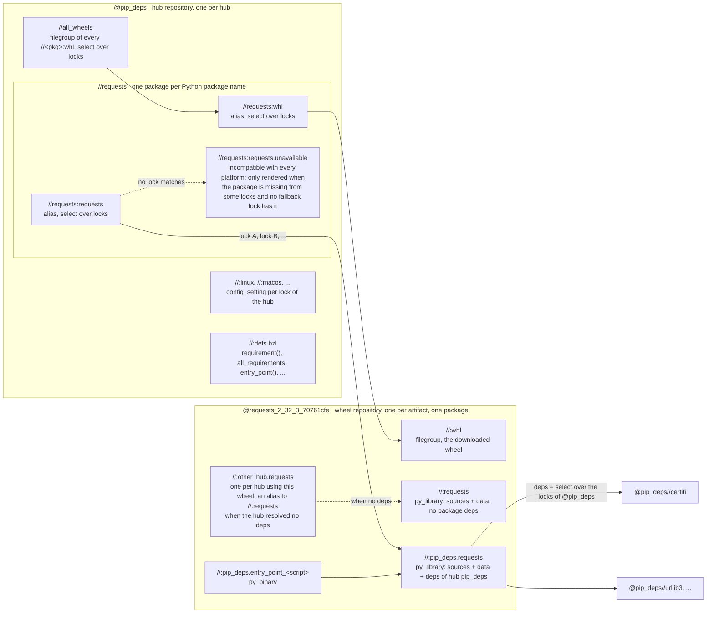

# Repository layout

How the `requirements` module extension turns lock files into Bazel targets, and where
dependencies are defined along the way.

## Where the dependency graph comes from

The graph is never computed by a repository rule. It is resolved once, when a lock file
is compiled, and from then on only copied around.

1. **Lock time.** `py_reqs_compiler` runs the req-compile solver and writes a lock file per
   platform. The edges of the graph survive only as the `# via` comments, which name the
   packages that required each pin.
2. **Extension time.** The extension parses every lock file of every hub and inverts the
   `# via` lines into a map of package to direct dependencies, per lock. It then plans the
   repositories: one wheel repository per distinct artifact, and one hub repository per
   hub. Each wheel repository is told which hubs use it and, per hub and lock, the direct
   dependencies that lock resolved for it.
3. **Analysis time.** The repository rules render those direct edges as labels. Bazel
   assembles the transitive graph by following them.

## Repositories

Two kinds of repository are generated.

**Hub repositories** (`@pip_deps`) are what BUILD files reference. A hub holds no files.
It is a set of aliases, one package per Python package name, plus the config settings
that select a lock and the `defs.bzl` helpers.

**Wheel repositories** (`@requests_2_32_3_70761cfe`) hold a downloaded and extracted
artifact. A wheel repository is named after the package, its version and the first eight
characters of its sha256, with a hash of the package annotation appended when one
applies. Dependencies play no part in the name, so every hub of every module that pins the
same artifact with the same annotation shares one repository.

## Targets



A reference to `@pip_deps//requests` therefore resolves as:

```
@pip_deps//requests:requests
  -> @requests_<sha>//:pip_deps.requests     (select on the lock of the current platform;
                                              sources of the wheel + deps of this hub)
       deps -> @pip_deps//certifi, @pip_deps//urllib3, ...   (each resolving the same way)
```

The deps of a per-hub library point back into the hub rather than at wheel repositories
directly. That is what lets the hub decide, per platform, which artifact satisfies a name
while the wheel repository stays shared.

## Who defines what

| Target | Defined from | Holds |
| --- | --- | --- |
| `@pip_deps//<pkg>:<pkg>` | the hub's `packages`, per lock | alias to the wheel repository the lock resolved |
| `@pip_deps//<pkg>:<pkg>.unavailable` | locks missing the package, without a fallback lock | `py_library` incompatible with every platform |
| `@pip_deps//:<lock>` | `config_settings` or the lock header | `config_setting` selecting the lock |
| `@<wheel>//:<pkg>` | the wheel's files | `py_library` with sources and data, deps only from annotation labels |
| `@<wheel>//:<hub>.<pkg>` | the hub's `# via` edges, per lock | `py_library` with the same sources and that hub's deps, or an alias to `//:<pkg>` when there are none |
| `@<wheel>//:<hub>.entry_point_<script>` | `entry_points.txt` | `py_binary` depending on the hub's target |
| `@<wheel>//:whl` | | the artifact |

## Why the package library has no package dependencies

Dependencies are a property of a hub, not of a wheel. Every Python dependency edge is a
label into a hub, because the hub is what maps a name to the artifact chosen for the current
platform. A wheel repository is shared by every hub pinning it, and those hubs may have
resolved different dependencies, for example when one asked for an extra. The package
library, `//:requests`, is the part of the wheel that is the same for everyone. Only explicit
labels from `py_package_annotation(deps = [...])` are attached to it, since those are
absolute.

The per-hub library owns the sources rather than depending on the package library so that
a single target carries both the sources and the dependencies. Tools that analyze one target
at a time, such as the mypy aspect of `rules_venv`, rely on that. When a hub resolved no
dependencies for a wheel the two would be identical, so the hub's target is an alias of the
package library instead. Most wheels are leaves, so most hubs' targets are aliases.

## Annotations

`py_package_annotation` changes the contents of a wheel repository, so an annotated wheel
gets a repository of its own even when another hub pins the same artifact without the
annotation. Annotation-defined targets are attached to the `data` of every library of the
repository, and `py_package_annotation_consumer` finds them on the target the hub alias
resolves to. It does not search dependencies, so the annotations of one package are never
mistaken for those of a package depending on it.
